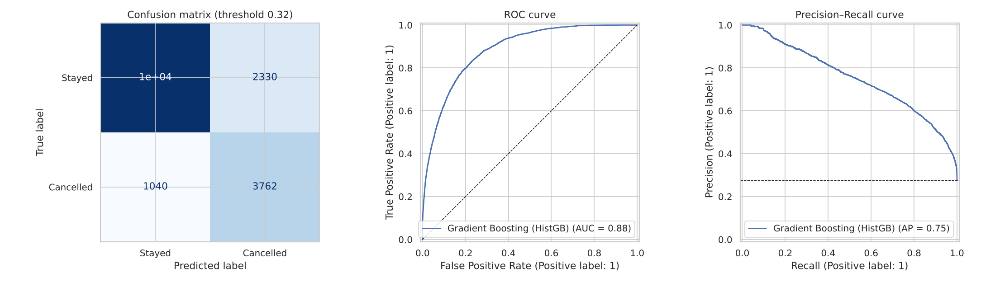

# 🏨 Hotel Booking Cancellation Predictor

**Hotels lose revenue when bookings are cancelled late. This project predicts which bookings will cancel and recommends a deposit policy (none / partial / full) for each risk level.**

   🔗 **Live app:** https://hotel-cancellation-nzgymhyu4cpclvjad7cdze.streamlit.app 
📓 **Notebook:** [`hotel_cancellation_ml.ipynb`](hotel_cancellation_ml.ipynb)



## Results (17,446 unseen test bookings, 27.5 % cancel)

| Model | ROC-AUC | PR-AUC | Precision | Recall | F1 |
|---|---|---|---|---|---|
| Baseline (always "stays") | 0.500 | 0.275 | 0.000 | 0.000 | 0.000 |
| Logistic Regression (tuned) | 0.816 | 0.631 | 0.514 | 0.750 | 0.610 |
| Random Forest (tuned) | 0.882 | 0.746 | 0.725 | 0.588 | 0.649 |
| Gradient Boosting (tuned) · threshold 0.5 | 0.884 | 0.754 | 0.722 | 0.590 | 0.649 |
| **Gradient Boosting (tuned) · threshold 0.317 (final)** | **0.884** | **0.754** | **0.618** | **0.783** | **0.691** |

The final threshold was chosen on out-of-fold training predictions (test set untouched). It catches **78 % of cancellations**; the model's **High-risk tier (17 % of bookings) cancels 77 % of the time**.

## What makes it solid
- **Leakage handled:** `reservation_status*`, `assigned_room_type`, `booking_changes` and `required_car_parking_spaces` (0 % of parked bookings cancel — filled only for arrivals) are excluded; `deposit_type` is excluded because it is the policy being recommended.
- Duplicates removed before splitting; everything fitted inside one scikit-learn `Pipeline` on the training split only.
- Cross-validation + randomized/grid search on training data only; probabilities are well calibrated, so they map directly to risk tiers.

## Run locally
```bash
pip install -r requirements.txt matplotlib seaborn
python train.py          # optional: retrain (needs hotel_bookings.csv)
streamlit run app.py     # launch the app
```
Download `hotel_bookings.csv` from [Kaggle](https://www.kaggle.com/datasets/jessemostipak/hotel-booking-demand) next to it (the data is not stored in this repo).

## Deploy
Push this folder to GitHub → [share.streamlit.io](https://share.streamlit.io) → New app → select `app.py`.

## Limitations
Two Portuguese hotels, 2015–2017; random split; deposit effects are not causal (A/B test before rolling out); weakest on last-minute, Direct and Corporate cancellations.

**Data:** Antonio, de Almeida & Nunes (2019), *Hotel booking demand datasets*, Data in Brief 22.
